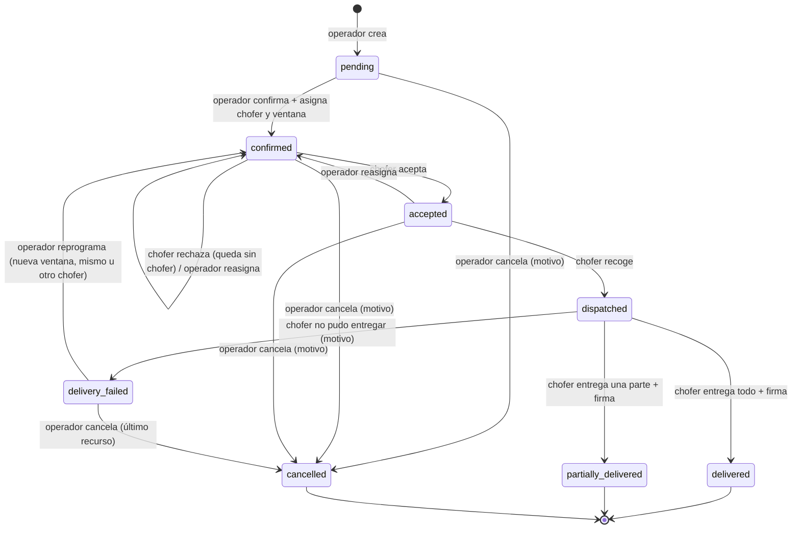

# Proceso de punta a punta del pedido (fulfillment) — diseño

Fecha: 2026-11-04 · Estado: fase 1 construida (rama feat/fulfillment-phase1) · Caso base: ECTEC ·
Caso de prueba: Uniempaques CR (marcado como **[Supuesto Uniempaques]**)

Convención de este documento: lo que dijo Emilio va sin marca. Lo que decidí
yo va marcado **(mi decisión)** y se puede cambiar. Lo que falta saber va en
§15.

---

## 1. Intención

Hoy el operador mueve el pedido por todos los estados a mano, incluso
"Despachado" y "Entregado", que en la realidad pasan en la calle. Eso hace que
el tablero diga lo que el operador cree, no lo que pasó.

Queremos que **cada paso lo marque quien lo vive**: la oficina confirma y
asigna, el chofer acepta, recoge y entrega, y el cliente firma. El cliente se
entera de cada paso sin preguntar por WhatsApp (correo + página de
seguimiento, como Amazon). La entrega firmada es el disparador de la factura.

Nellio es un SaaS para varias distribuidoras, y el proceso de cada una puede
variar. La solución tiene que absorber esas diferencias **sin un motor de
procesos libre** (KISS) y sin reescribir código por cada cliente (SOLID).

## 2. Objetivos, no objetivos, anti-objetivos

**Objetivos**
- El chofer tiene su sesión, ve **solo sus pedidos** y marca aceptar, recoger
  y entregar desde el celular.
- Entrega con prueba: firma en el celular del chofer, nombre de quien recibe,
  hora y foto opcional.
- Cada salida mala del camino feliz tiene su rama (rechazo, entrega fallida,
  entrega parcial, cancelación, corrección manual).
- El cliente recibe un correo en cada paso importante y tiene un link de
  seguimiento sin login.
- Una empresa nueva con un proceso distinto se configura con datos, sin
  tocar código (§11).

**No objetivos (por ahora)**
- Optimizar rutas u ordenar las paradas (Emilio: el orden no importa).
- GPS en vivo o una hora estimada calculada por GPS.
- Inventario, bodegas o stock (sigue pendiente del discovery, CLAUDE.md §4).
- La pantalla para que cada empresa edite su proceso (llega con el segundo
  cliente real, §11).
- La integración con Hacienda (§12, pendiente de la pregunta 9).
- Conciliación de cobros (el chofer registra lo que cobró; cuadrar la caja
  queda fuera).

**Anti-objetivos (aunque funcione, sería un fracaso si…)**
- …el operador puede seguir marcando "Entregado" sin que el chofer lo haya
  hecho (salvo la corrección del admin con motivo, §8).
- …un chofer ve pedidos de otro chofer, precios línea por línea o
  estadísticas del negocio.
- …un correo que falla bloquea o deshace un cambio de estado.
- …configurar a un cliente nuevo puede romper la facturación o las
  estadísticas de otro.

## 3. Actores

| Actor | Qué hace en este proceso |
|---|---|
| Operador / Admin | Crea el pedido, lo prepara en bodega, lo confirma, asigna chofer y ventana de entrega, reasigna, reprograma, cancela |
| Admin | Además: corrección manual de estado con motivo (§8) |
| Chofer | Una cuenta **por chofer** (rol `driver`, ya existe). Acepta o rechaza, recoge, entrega (total, parcial o fallida), registra el cobro |
| Cliente | No es usuario (ADR-004, ADR-008). Recibe correos, abre el link de seguimiento y firma en el celular del chofer |

Preparar el pedido en bodega lo hace el operador o el admin; **no hay paso
"Listo en bodega"** por ahora. El chofer, al recoger, confirma que está
completo.

## 4. Categorías y estados

Patrón de Linear/HubSpot: **categorías fijas en el código** y **estados de
cada empresa dentro de cada categoría**. Todo el comportamiento (permisos,
correos, factura, estadísticas, vista del chofer) cuelga de la categoría o de
la acción, nunca del nombre de un estado.

| Categoría (fija) | Estado ECTEC (clave) | Nombre en pantalla | Quién lo pone |
|---|---|---|---|
| `to_confirm` | `pending` | Pedido | Operador/Admin al crear |
| `preparing` | `confirmed` | Confirmado | Operador/Admin (con chofer + ventana) |
| `preparing` | `accepted` | Aceptado por chofer | Chofer |
| `in_transit` | `dispatched` | En camino | Chofer al recoger |
| `in_transit` | `delivery_failed` | Entrega fallida | Chofer |
| `delivered` | `delivered` | Entregado | Chofer (con firma) |
| `delivered` | `partially_delivered` | Entregado parcial | Chofer (con firma) |
| `cancelled` | `cancelled` | Cancelado | Operador/Admin con motivo |

`pending`, `confirmed`, `dispatched` y `delivered` ya existen, así que los
pedidos actuales no cambian de clave.

La **factura no es un estado**: es un dato aparte del pedido
(`invoice_status`: sin facturar / pendiente / emitida / error). Así el
proceso de entrega y el de facturación no se mezclan, y cada país puede
facturar en un momento distinto (§12). **(mi decisión)**

## 5. Camino feliz, paso a paso

| # | Quién | Acción | Estado | Correo al cliente |
|---|---|---|---|---|
| 1 | Operador/Admin | Captura el pedido (flujo actual) | Pedido | "Recibimos tu pedido" + link de seguimiento |
| 2 | Operador/Admin | Lo prepara, lo confirma, asigna chofer y ventana de entrega ("mañana 8–12") | Confirmado | "Tu pedido está confirmado, llega {ventana}" |
| 3 | Chofer | Ve el pedido en "Mis pedidos" y lo acepta | Aceptado por chofer | — **(mi decisión: no aporta al cliente)** |
| 4 | Chofer | Lo recoge en bodega, revisa que esté completo, toca "Recogido" | En camino | "Tu pedido va en camino" |
| 5 | Chofer | Llega, el cliente firma en su celular, escribe el nombre de quien recibe, foto opcional, registra el cobro | Entregado | "Tu pedido fue entregado" + nombre de quien recibió y hora |
| 6 | Sistema | Dispara la facturación del país (§12) | (factura: pendiente/emitida) | Factura adjunta cuando exista |

Un chofer lleva **varios pedidos en el mismo viaje**: "Mis pedidos" lista
todo lo asignado y cada pedido se acepta, recoge y entrega por separado.
**(mi decisión)** Un botón "Recoger todos los aceptados" para no tocar uno
por uno.

## 6. Ramas y salidas alternativas

| Situación | Qué pasa | Estado resultante | Aviso |
|---|---|---|---|
| El chofer **rechaza** el pedido | Se le quita el chofer y se avisa al operador en el tablero | Confirmado sin chofer | Ninguno al cliente |
| El chofer **no responde** | **(mi decisión)** Sin vencimiento automático: el tablero marca "sin aceptar desde hace X h" y el operador decide | Confirmado | — |
| El operador **reasigna** antes de que lo recojan | Cambia el chofer; el anterior deja de verlo | Confirmado | — |
| El cliente **no está, está cerrado o rechaza** todo | El chofer marca "No se pudo entregar" con motivo (lista fija + "otro") y foto opcional. El pedido vuelve a bodega | Entrega fallida | "No pudimos entregar tu pedido, te contactaremos" |
| Reintento | El operador reprograma con nueva ventana y el mismo u otro chofer. El tablero muestra "intento N" | Confirmado | "Nueva fecha de entrega: {ventana}" |
| Nada funciona | Cancelar como último recurso, con motivo | Cancelado | "Tu pedido fue cancelado" |
| El cliente **recibe solo una parte** | §7 | Entregado parcial | "Tu pedido fue entregado parcialmente" + qué faltó |
| El celular del chofer **no tiene señal** | Fase 3 (§13). En fase 1 la app avisa que no hay conexión y no deja confirmar la entrega hasta tenerla | — | — |
| El cliente **no tiene correo** | No se manda nada; en la ficha del pedido se ve "Sin correo, compartir link por WhatsApp" con botón para copiar el link | — | — |
| El correo **falla** | El cambio de estado queda igual; se reintenta en segundo plano y queda registrado | — | — |
| Dos personas mueven el mismo pedido a la vez | Se rechaza el segundo movimiento (el patrón actual de "estado esperado") | — | — |

No hay límite de intentos. **(mi decisión)** El contador de intentos queda
visible para que el operador decida cuándo cancelar.

## 7. Entrega parcial (como Amazon y Rappi)

- Al entregar, el chofer ve las líneas con la cantidad pedida y por defecto
  "todo entregado". Puede bajar la cantidad de una línea y elegir el motivo:
  no lo quiso, venía dañado, no alcanzó u otro.
- Si alguna línea queda por debajo de lo pedido, el pedido pasa a
  **Entregado parcial**. Lo no entregado vuelve con el chofer a bodega.
- Lo que faltó **no se reenvía automáticamente**. El operador ve un botón
  "Crear pedido con lo pendiente", que crea un pedido nuevo para el mismo
  cliente con esas líneas.
- La factura (o nota de crédito) usa **lo entregado**, no lo pedido. Por eso
  la cantidad entregada se guarda por línea, aparte de la pedida.
- Entregar 0 de todo no es una entrega parcial: es una entrega fallida.

## 8. Cancelación y corrección manual

**Cancelar** (operador o admin, siempre con motivo):

| Estado | ¿Se puede cancelar? |
|---|---|
| Pedido, Confirmado, Aceptado | Sí. Si había chofer, deja de verlo |
| En camino | No. Si el cliente no lo quiere, es una entrega fallida |
| Entrega fallida | Sí (último recurso) |
| Entregado / Entregado parcial | Nunca. Lo que corresponde es una devolución o nota de crédito (fuera de alcance) |

**Corrección manual (solo admin)**: para cuando la realidad y el sistema no
cuadran (al chofer se le murió el celular, entregó y no marcó). El admin
puede poner el pedido en cualquier estado, **con motivo obligatorio**, y
queda en el historial como corrección. Si lo pone en Entregado sin firma, el
pedido queda marcado "entregado sin firma". El operador **no** tiene esta
opción. **(mi decisión, propuesta antes y no objetada)**

**Editar el pedido** (productos, cantidades, precios, cliente): se puede
hasta **Aceptado por chofer**. Desde **En camino** queda bloqueado, en el
servidor y no solo en pantalla. Lo que cambie en la calle se resuelve como
entrega parcial (§7). Si se edita estando Aceptado, el chofer ve el pedido
actualizado.

**Tablero del operador** (`/orders`): una columna por estado. Arrastrar se
mantiene solo de **Pedido → Confirmado**; al soltar se abre el panel para
elegir chofer y ventana, y si se cierra sin guardar, el pedido vuelve a
Pedido. Las columnas del chofer (Aceptado, En camino, Entrega fallida,
Entregado, Entregado parcial) son solo de lectura y se actualizan en vivo
(ADR-010). Cancelar, reasignar y reprogramar se hacen desde el detalle del
pedido. En el teléfono, el botón "siguiente paso" y "Mover a…" solo ofrecen
esas mismas acciones.

## 9. Prueba de entrega y cobro

- **Firma** dibujada en el celular del chofer + **nombre de quien recibe**
  (obligatorios en ECTEC) + **hora** (la pone el servidor) + **foto**
  opcional.
- Firma y foto se guardan como archivos privados del tenant; solo los ven
  operador y admin de esa empresa.
- **Cobro**: el chofer elige método (efectivo, cheque, transferencia,
  crédito) y, si cobró, el monto. Emilio: pueden pasar todas.
- **(mi decisión)** El chofer ve los productos y el **total a cobrar**, pero
  no los precios línea por línea ni nada de estadísticas.

## 10. El cliente: correos y página de seguimiento

**Correos** en los pasos marcados en §5 y §6. Si el correo falla o el
cliente no tiene correo, el proceso sigue igual.

**Página de seguimiento**: un link con un código imposible de adivinar, sin
login (el "paso intermedio" de ADR-008). Muestra:
- empresa, número de pedido y estado actual;
- la línea de tiempo con la hora de cada paso;
- la **hora estimada** = la ventana de entrega que el operador fijó al
  confirmar (no GPS);
- si se entregó: quién recibió y a qué hora.

**(mi decisión)** No muestra precios, ni la firma, ni la foto, ni datos del
chofer más allá del nombre de pila. El link deja de funcionar 30 días
después de entregado o cancelado.

## 11. Proceso distinto por empresa (configuración)

Tres capas, de la más fija a la más flexible:

1. **Categorías** (§4): fijas en el código. Nunca cambian por cliente.
2. **Estados**: una tabla por empresa (clave, nombre en pantalla, categoría,
   orden). ECTEC arranca con los 8 de §4. Una empresa nueva puede tener otros
   nombres u otros estados **dentro de las mismas categorías**.
3. **Interruptores** por empresa, con columnas tipadas y no un JSON libre
   **(mi decisión)**:
   - `require_driver_acceptance` (ECTEC: sí)
   - `require_signature` (ECTEC: sí)
   - `require_receiver_name` (ECTEC: sí)
   - `require_photo` (ECTEC: no)
   - qué eventos mandan correo (ECTEC: los de §5/§6)

Si una empresa apaga `require_driver_acceptance`, el pedido salta de
Confirmado a poder recogerse directamente.

**Ahora** solo se construyen los estados y los interruptores de ECTEC,
cargados por migración. No hay pantalla de configuración: se cambian por base
de datos. Los estados extra de otra empresa, con sus reglas de quién los
mueve, se diseñan cuando haya un segundo cliente real (§14).

Si una empresa no cabe en estas categorías (p. ej. fabrica en vez de
distribuir), no es cliente de Nellio; se detecta en el discovery.

## 12. Facturación por país

- Al entrar en la categoría `delivered`, el sistema llama a "facturar" de
  forma independiente del país. Cada país enchufa su implementación: DTE en
  El Salvador, factura electrónica en Costa Rica, etc. El flujo de entrega no
  sabe nada del formato.
- **ECTEC hoy**: no hay implementación todavía; la factura queda **pendiente**
  y se ve en el pedido.
- **Pregunta 9 abierta**: si ECTEC tiene que emitir la factura **antes** de
  que salga el camión (el papel viaja con la mercadería), el disparador pasa
  a la categoría `in_transit` y lo entregado de menos se ajusta con nota de
  crédito. Esto se resuelve con el contador / el Manual Tecnológico de
  Hacienda (ADR-007), no por suposición.
- La **moneda** se guarda en la empresa (USD para ECTEC), no se asume.

## 13. Fases propuestas

| Fase | Qué incluye | Por qué en este orden |
|---|---|---|
| **1. Chofer y estados** | Estados nuevos + historial de cada cambio + cambios de estado solo por acciones del servidor (adiós al cambio directo del operador) + asignar chofer y ventana + vista "Mis pedidos" del chofer (en línea) + aceptar/rechazar/recoger/entregar/parcial/fallida + firma, nombre, foto y cobro + cancelar con motivo + corrección del admin + tablero adaptado | Es lo que hoy no cuadra (Emilio) |
| **2. Cliente** | Correos + página de seguimiento | Necesita el historial de la fase 1 |
| **3. Sin señal** | El celular del chofer guarda la entrega (firma, foto, cantidades) y la envía sola cuando vuelve la señal | La pieza más cara; la fase 1 ya funciona con señal |
| **4. Factura SV** | DTE de ECTEC | Bloqueada por la pregunta 9 |
| **5. Configuración por empresa** | Pantalla de estados e interruptores | Con el segundo cliente real |

## 14. Prueba con Uniempaques CR

Todo lo de esta sección es **[Supuesto Uniempaques]**, sacado de su sitio
web, sin hablar con ellos. Se confirma en el pitch.

| Supuesto | Cómo cabe en el diseño | ¿Rompe algo? |
|---|---|---|
| Cotizan antes de cada pedido (el cliente pide precio y luego acepta) | Estados propios en `to_confirm`: "Cotización enviada" → "Cotización aprobada" → luego Confirmado | No. Necesita la capa 2 de §11 y probablemente un correo de "cotización" |
| Envían a otros países de Centroamérica con paquetería | En `in_transit`, "Enviado por paquetería" con número de guía en vez de chofer. La entrega la confirma el operador con la prueba de la paquetería | Sí, un poco: la acción "entregar" la hace la oficina, no un chofer. Sería un interruptor nuevo ("¿quién confirma la entrega?") |
| Facturan con Hacienda de Costa Rica, en colones | Otra implementación de "facturar" (§12) + moneda por empresa | No, si §12 se respeta desde la fase 1 |
| Venden maquinaria, quizá con instalación | Fuera de alcance | — |

Conclusión provisional: las categorías alcanzan. Lo único nuevo sería "la
entrega la confirma la oficina" para la paquetería.

Preguntas para el pitch: cómo les llegan hoy los pedidos y quién los pasa a
su sistema; si cotizan siempre o solo a clientes nuevos; si entregan con
camión propio, paquetería o ambos; con qué facturan; qué les quita más tiempo
al día.

## 15. Abierto

- **Pregunta 9** (§12): ¿la factura se emite antes de salir o al entregar?
- ¿Las ventanas de entrega son libres ("mañana 8–12") o la empresa tiene
  franjas fijas? Hasta saberlo: texto libre con fecha. **(mi decisión)**
- Motivos de entrega fallida y de cancelación: propongo una lista fija
  ("cliente cerrado", "cliente rechazó", "dirección incorrecta", "otro" con
  texto). Confirmar con Milo/Alejandra.

## 16. Restricciones técnicas (para quien lo construya)

- Hoy RLS deja que operador y admin hagan `UPDATE` directo de
  `orders.status`. En la fase 1 el estado **solo** cambia por funciones del
  servidor que validan quién puede hacer qué transición; el cambio directo
  se bloquea. Mismo cuidado con las columnas nuevas (chofer asignado,
  cantidades entregadas, firma).
- El chofer hoy no ve ningún pedido (RLS solo operador/admin). Necesita
  políticas nuevas: ve **solo** los pedidos donde él es el chofer asignado, y
  solo los campos que le tocan (§9).
- El historial (quién, cuándo, de qué estado a cuál, motivo) lo escribe el
  servidor, nunca el cliente de la API (CLAUDE.md §7, columnas de auditoría).
  Sirve para la línea de tiempo de seguimiento, para los correos y para el
  TODO "Show who else changed an order".
- Toda política nueva usa `(select public.tenant_id())` (ADR-009). Realtime:
  el tablero del chofer sigue el mismo patrón de ADR-010 (señal y volver a
  pedir; nada de DELETE).
- Las estadísticas del admin (`get_today_stats`) cuentan por categoría, no
  por clave de estado.
- Pedidos viejos en Confirmado/Despachado sin chofer: el admin los cierra con
  la corrección manual. **(mi decisión)**
- Proveedor de correo: se elige al construir la fase 2.
- **Alcance del plan: solo la fase 1**, pero lista para la fase 3: la
  acción "entregar" acepta un id generado en el celular y repetirla no
  duplica nada (idempotente); firma y foto se suben aparte y se enlazan a esa
  entrega. Así "sin señal" no obliga a rehacer la fase 1. **(mi decisión)**
- **Cómo una acción sabe a qué estado ir** cuando los estados son de cada
  empresa: cada estado tiene un `step` fijo opcional (`created`, `confirmed`,
  `accepted`, `picked_up`, `delivery_failed`, `delivered`,
  `partially_delivered`, `cancelled`). Las acciones del servidor buscan el
  estado de la empresa con ese `step`. Los estados propios de otra empresa
  (§14) van sin `step`: son informativos dentro de su categoría. **(mi
  decisión)**
- **Corrección del admin y factura**: corregir hacia Entregado dispara la
  facturación igual que una entrega normal (marcada "sin firma"). Sacar un
  pedido de Entregado solo se permite si la factura no está emitida; una vez
  emitida, el camino es la nota de crédito (fuera de alcance). **(mi
  decisión)**
- **Lo que ve el chofer del cliente**: nombre, dirección y teléfono, a
  través de una función o vista solo para choferes (RLS no oculta columnas),
  sin acceso directo a la tabla `customers`. Ve sus pedidos activos y los que
  cerró en los últimos 7 días. **(mi decisión)**

## 17. Queda a criterio de quien construya

Forma exacta de las tablas y funciones, nombres internos, diseño visual de la
vista del chofer (siguiendo DESIGN.md), librería de firma, y cómo se envían
los correos en segundo plano, siempre que se respeten §2, §11, §12 y §16.
